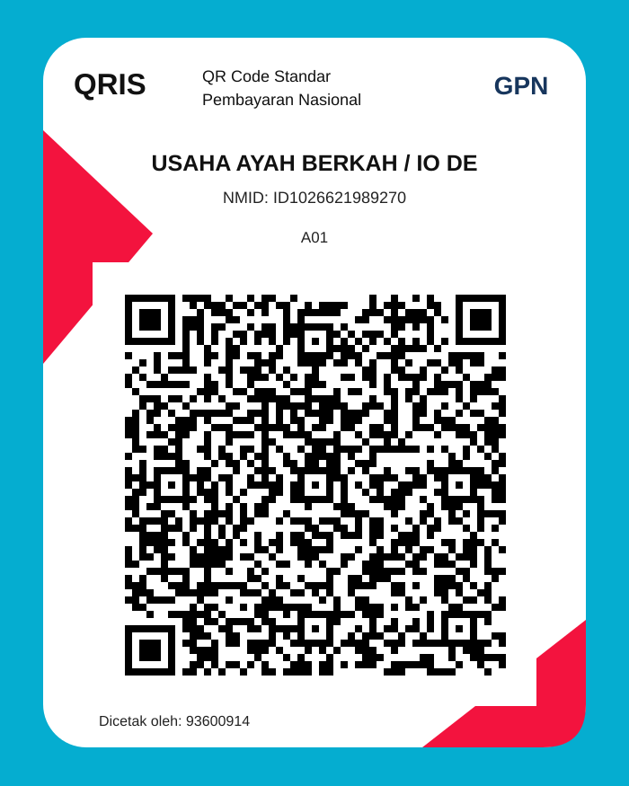

<!-- ================= AI RULEBOOK V3 ================= -->

<div align="center">


<a href="https://github.com/andikune-ux/ai-rulebook">
  
</a>

<br/>


<br/><br/>

**One Rulebook. Every Platform. Exceptional Experiences.**

*Strict where it matters. Flexible where it makes sense.*

[Getting Started](#-mulai-menggunakan) ·
[Core Rules](core/) ·
[Platform Rules](platforms/) ·
[Support](#-support--donasi)

</div>

---

<div align="center">


## ✦ SYSTEM INITIALIZED ✦


</div>

## 🚀 Tentang AI Rulebook

AI Rulebook adalah pusat instruksi dan standar kerja untuk AI coding assistant pada **semua jenis aplikasi**. V3 menggunakan **Universal + Auto Detection** dan **Risk-Based Approval** dengan prinsip ketat tetapi fleksibel.

Targetnya bukan sekadar membuat aplikasi yang bisa berjalan, tetapi aplikasi yang fungsional, aman, stabil, mudah dikembangkan, dan memiliki pengalaman pengguna berkualitas tinggi.

## 🌐 Universal Platform Support

AI wajib mendeteksi platform dan teknologi proyek sebelum menentukan implementasi.

| Platform | Teknologi / Cakupan |
|---|---|
| 📱 Android | Kotlin, Java, Jetpack Compose, XML |
| 🍎 iOS | Swift, SwiftUI |
| 🌍 Web | HTML, CSS, JavaScript, TypeScript |
| ⚙️ Backend | Node.js, Python, Go, Java, dan lainnya |
| 🖥️ Desktop | Windows, macOS, Linux |
| 🔄 Cross-platform | Flutter, React Native, dan lainnya |
| 🔌 API & Integrasi | REST, GraphQL, WebSocket |
| ☁️ Infrastruktur | Database, cloud, CI/CD, deployment |

Aturan inti berlaku untuk semua proyek. Aturan khusus platform hanya dimuat jika relevan.

## ✨ Standar Pengembangan

### 🎨 Premium UI/UX
- Modern, profesional, konsisten, dan responsif.
- Design system, typography, spacing, dan komponen yang terstruktur.
- Dark mode / light mode jika relevan.
- Loading, empty, error, dan success state.
- Accessibility dan keterbacaan.

### ⚡ Motion & Interaction
- Smooth screen dan page transitions.
- Animated navigation, buttons, cards, dialogs, dan menus.
- Micro-interactions dan gesture feedback.
- Loading, progress, success, dan error animations.
- Lottie, vector, parallax, atau 3D effects jika sesuai.
- Animasi harus bermakna, menghormati reduced-motion, dan tidak merusak performa.

### 🧠 Engineering Quality
- Clean architecture dan reusable components.
- Pemisahan UI, business logic, dan data layer.
- Error handling dan logging yang aman.
- Testing, dokumentasi, dan optimasi performa.
- Tidak mengarang hasil build, test, atau deployment.

<div align="center">

</div>

## 🧩 Lima Kapabilitas Wajib Aplikasi

Setiap pembangunan aplikasi wajib mengevaluasi dan mengimplementasikan lima kelompok berikut dengan pendekatan sesuai platform.

1. **Permission Management** — hanya meminta permission/capability yang benar-benar diperlukan.
2. **Service & Helper** — gunakan service, helper, repository, atau modul pendukung bila memang dibutuhkan arsitektur.
3. **Crash Recovery** — deteksi crash sebelumnya saat aplikasi dibuka kembali; tampilkan log dengan tombol Salin Log dan Kembali.
4. **Update Notification** — cek release terbaru dari sumber tepercaya; tampilkan changelog dan pilihan Skip, Nanti, Update.
5. **Structured Storage** — folder privat bernama aplikasi dengan kategori Pembaruan Aplikasi dan Log Crash.

Detail implementasi dan kriteria penerimaan: [core/MANDATORY_APP_CAPABILITIES.md](core/MANDATORY_APP_CAPABILITIES.md).

## 🛡️ Security & Privacy

- Lindungi data sensitif dan jangan mengekspos API key atau secret.
- Validasi input dan terapkan autentikasi/otorisasi yang tepat.
- Gunakan komunikasi terenkripsi dan secure storage jika relevan.
- Hindari permission yang tidak diperlukan.
- Redaksi informasi pribadi dari log.
- Jangan mengirim crash report tanpa persetujuan yang sesuai.

## ⚙️ Performance & Testing

Perhatikan startup time, rendering, frame rate, CPU/GPU, RAM, network, battery, dan ukuran asset.

Sebelum release, evaluasi build, fitur utama, navigasi, animasi, permission, crash recovery, update flow, storage, keamanan, accessibility, dan performa.

Gunakan status:
- `PASS`
- `FAIL`
- `NOT RUN`
- `NOT APPLICABLE`

Jangan menyatakan fitur berhasil jika belum diuji.

## 🧠 Risk-Based Approval

| Level | Kebijakan |
|---|---|
| 🟢 LOW | AI boleh lanjut dan melaporkan |
| 🟡 MEDIUM | Boleh lanjut dengan safeguards jika scope jelas |
| 🟠 HIGH | Wajib persetujuan eksplisit sebelum tindakan |
| 🔴 CRITICAL | Stop, eskalasi, dan minta otorisasi spesifik serta mitigasi |

Jika ragu, gunakan level risiko lebih tinggi. Akses tool bukan persetujuan.

## 📁 Struktur Repository

```text
ai-rulebook/
├── README.md
├── AGENTS.md
├── CLAUDE.md
├── CHANGELOG.md
├── assets/
│   └── donation-qris.svg
├── core/
│   ├── PRINCIPLES.md
│   ├── AI_BEHAVIOR.md
│   ├── CODING_RULES.md
│   ├── SECURITY.md
│   ├── TESTING.md
│   ├── DATABASE.md
│   ├── RELEASE.md
│   ├── RISK_POLICY.md
│   └── MANDATORY_APP_CAPABILITIES.md
├── platforms/
│   ├── README.md
│   ├── android/
│   ├── ios/
│   ├── web/
│   ├── backend/
│   ├── desktop/
│   ├── cross-platform/
│   └── api/
├── workflows/
├── templates/
└── docs/
    └── AI_CHECKLIST.md
```

## 🚀 Mulai Menggunakan

### 1. Clone repository

```bash
git clone https://github.com/andikune-ux/ai-rulebook.git
cd ai-rulebook
```

### 2. Berikan instruksi kepada AI

```text
Gunakan AI Rulebook V3 sebagai standar wajib proyek ini.

Baca README.md, AGENTS.md, dan seluruh core rules.
Audit repository sebelum melakukan perubahan.
Deteksi semua platform dan teknologi secara otomatis.
Muat aturan platform yang relevan.

Terapkan:
- Universal engineering standards
- Risk-based approval
- Premium UI/UX dan motion design
- Lima mandatory application capabilities
- Security, privacy, testing, dan performance

Jangan melakukan tindakan HIGH/CRITICAL tanpa approval.
Jangan mengarang hasil build, test, atau deployment.
```

## 📚 Dokumentasi

| Resource | Keterangan |
|---|---|
| [Core Rules](core/) | Aturan engineering universal |
| [Platform Rules](platforms/) | Aturan khusus platform |
| [Workflows](workflows/) | Prosedur pengembangan |
| [Templates](templates/) | Template proyek |
| [AI Checklist](docs/AI_CHECKLIST.md) | Checklist verifikasi |
| [Changelog](CHANGELOG.md) | Riwayat perubahan |

---

<div align="center">

## 💙 Support & Donasi

Jika AI Rulebook bermanfaat dan membantu pekerjaanmu, kamu bisa mendukung pengembangannya melalui donasi sukarela.

Tidak ada nominal wajib. Dukungan sekecil apa pun sangat berarti dan membantu proyek ini terus dikembangkan.



**Scan QRIS di atas menggunakan aplikasi pembayaran yang mendukung QRIS.**

<sub>Pastikan nama merchant yang tampil di aplikasi pembayaran sesuai sebelum mengonfirmasi transaksi.</sub>

<br/>

<a href="https://github.com/andikune-ux">
  
</a>
<a href="https://chat.whatsapp.com/BAejUrfRW39FOt8biJleUM">
  
</a>
<a href="https://www.tiktok.com/@nayyra.une">
  
</a>
<a href="https://www.instagram.com/nayyra.une">
  
</a>

<br/><br/>

**Terima kasih sudah mampir, menggunakan, dan mendukung AI Rulebook!**


<sub>AI RULEBOOK V3 · UNIVERSAL APPLICATION ENGINEERING</sub>

</div>
